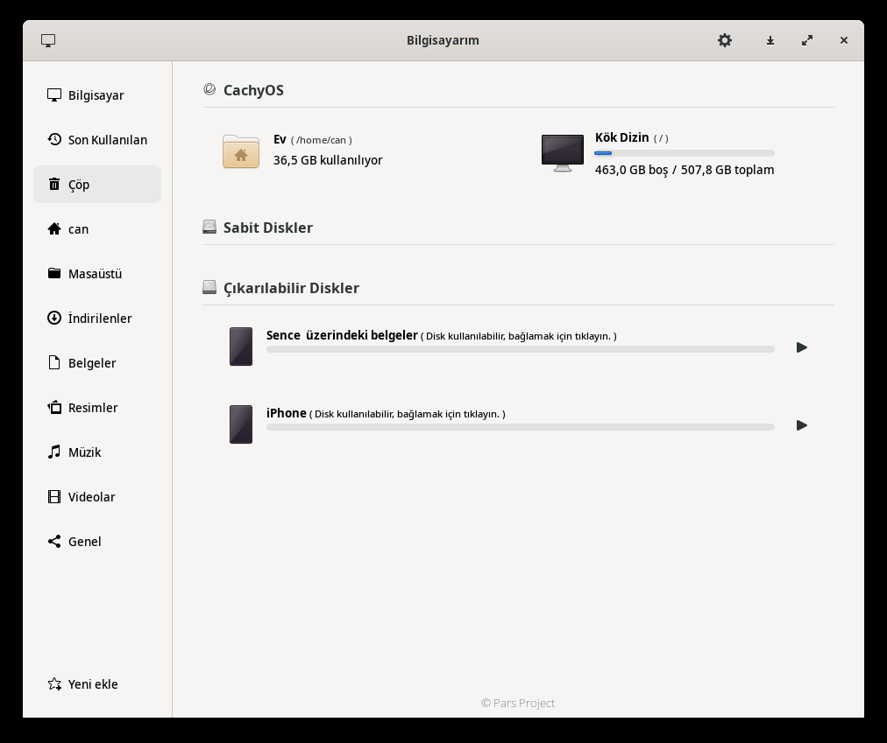
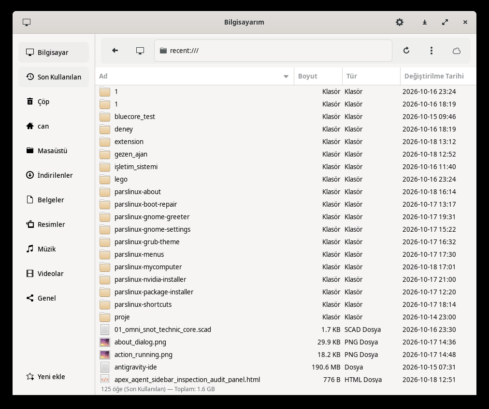
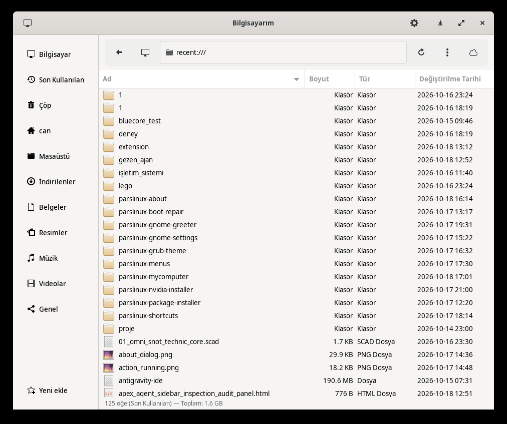
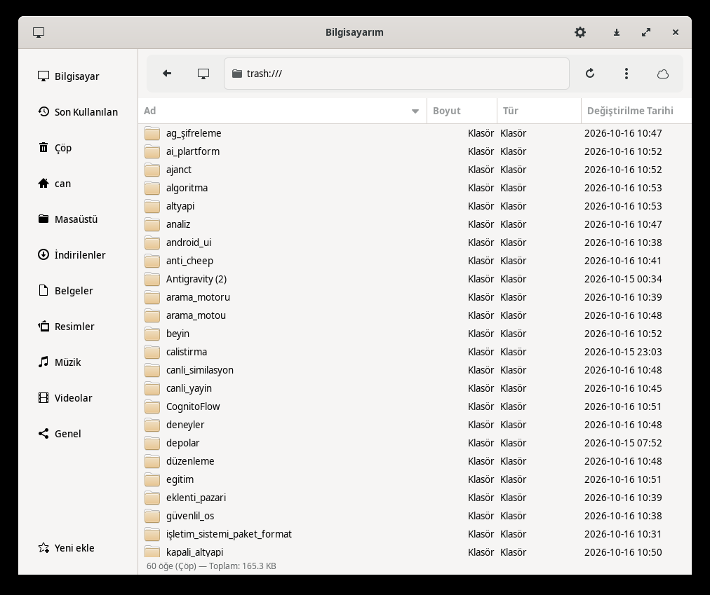
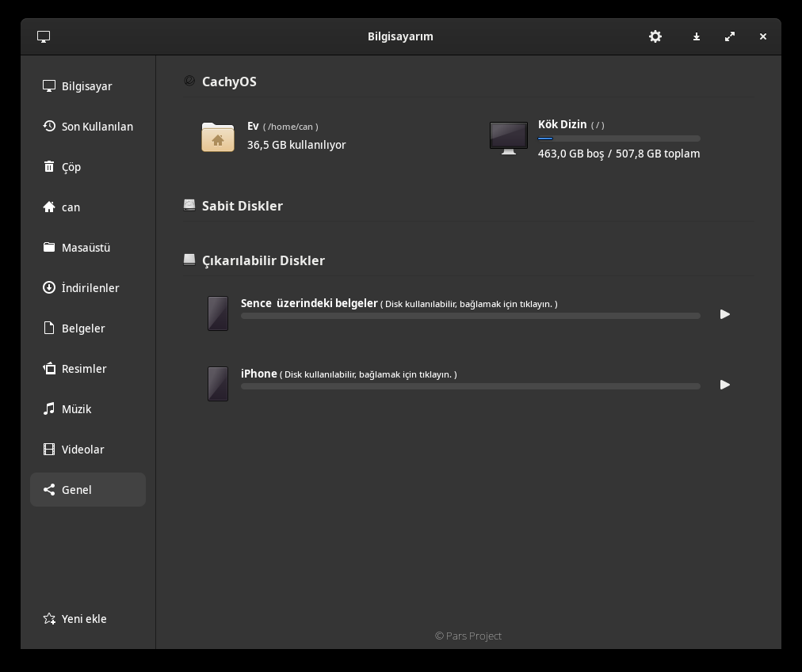

# Pars My Computer

Pars My Computer is a modern UI for information and management of disks on your computer.

It is currently a work in progress. Maintenance is done by <a href="https://www.pars.org.tr/">Pars</a> team.

[](https://repology.org/project/pars-mycomputer/versions)

### **Dependencies**

This application is developed based on Python3 and GTK+ 3. Dependencies:
```bash
gir1.2-glib-2.0 gir1.2-gtk-3.0 gir1.2-notify-0.7 gir1.2-pango-1.0 gvfs-fuse python3-gi python3
```

### **Run Application from Source**

Install dependencies
```bash
sudo apt install gir1.2-glib-2.0 gir1.2-gtk-3.0 gir1.2-notify-0.7 gir1.2-pango-1.0 gvfs-fuse python3-gi python3
```

Clone the repository
```bash
git clone https://github.com/pars/pars-mycomputer.git ~/pars-mycomputer
```

### **Quick Start**

Run application directly from source:
```bash
./run.sh
```

### **Installation & Removal**

Install system-wide:
```bash
sudo ./install.sh
```

Uninstall completely:
```bash
sudo ./uninstall.sh
```

### **Packaging**

Build Arch Linux (`.pkg.tar.zst`), Debian (`.deb`), and source tarball (`.tar.gz`) packages into `dist/`:
```bash
./package.sh all
```

---

### **Documentation & Project Resources**

- **[Documentation Index](docs/README.md):** Complete guide to all project documentation
- **[Installation Guide](docs/INSTALL.md):** Detailed step-by-step setup and packaging
- **[Architecture & Design](docs/ARCHITECTURE.md):** Technical modular breakdown
- **[Developer Guide](docs/DEVELOPMENT.md):** Contributor and development workflow
- **[Progress Tracker](progress.md):** Feature progress and roadmap status
- **[Claude AI Guide](claude.md):** Assistant guidelines and project instructions
- **[Virtual Test Guide](docs/test_calistirmasi.md):** Loop device test procedures

### **Screenshots**










